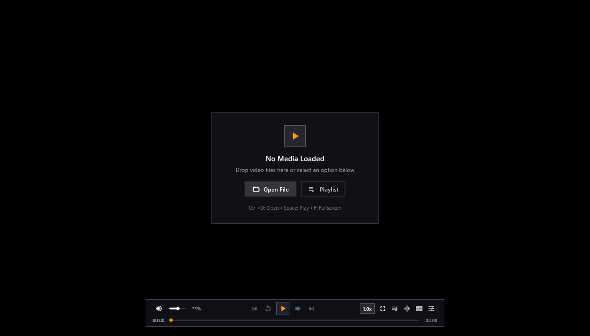
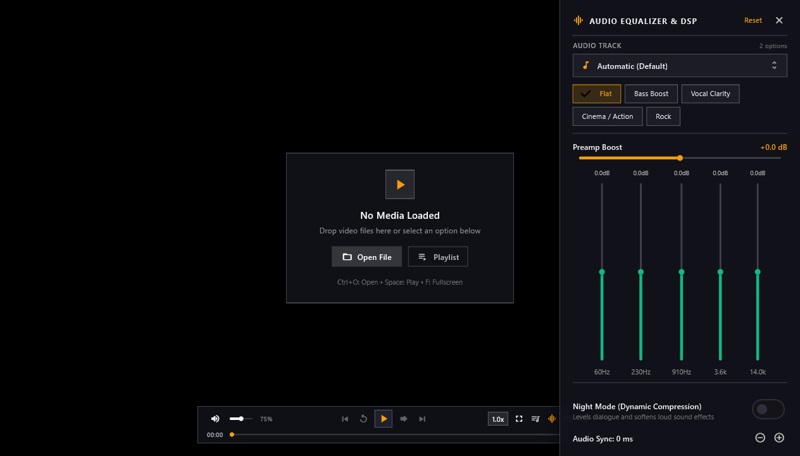
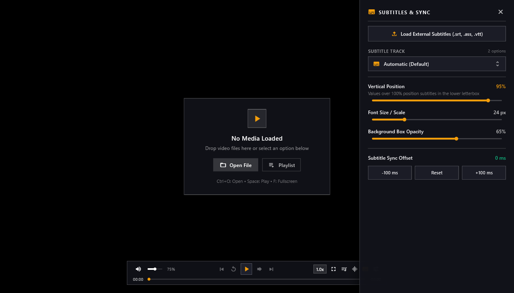

# MyPlayer Pro

A lightweight Windows desktop video player built with Flutter, Riverpod, and libmpv (`media_kit`).

## Screenshots

### Main Interface
Floating HUD playback controls, responsive seek scrub, and minimalist file drop card.



### Audio Equalizer & DSP Panel
Graphic equalizer with presets, preamp gain control, night mode dynamic range compression, and audio delay sync.



### Subtitles & Track Management
Subtitles drawer with track selection, external subtitle loader, positioning, font scaling, and delay calibration.



## Features

- **Minimal HUD Playbar**: Centered floating controls bar with volume, playback controls, seek slider, and track settings. Auto-hides with the mouse cursor during playback.
- **Seeking Controls**:
  - Separate buttons for seeking and playlist track navigation.
  - Keyboard seeking with input coalescing to prevent queued seek operations during rapid key presses.
  - Drag-and-release seek bar with local time scrub preview.
- **Volume & Mute**:
  - Volume slider synchronized with keyboard controls (Up/Down arrows).
  - Quick mute toggle (M key or volume icon click) with previous volume restoration.
- **Fast Exit**: Window close events are intercepted to mute and stop the player immediately without trailing audio buffer playback.
- **On-Screen Display (OSD)**: Feedback overlay for seek offsets, volume changes, playback rate, and loaded media.
- **Configurable Shortcuts**:
  - Adjustable seek step (seconds) and volume step (percentage).
  - Customizable key bindings with conflict detection and persistence via SharedPreferences.
- **Audio Controls**:
  - 5-band equalizer with presets and preamp adjustment.
  - Dynamic range compressor (night mode) and audio delay synchronization.
- **Subtitle Controls**:
  - Subtitle vertical position, font size, and background opacity controls.
  - Subtitle delay timing adjustment.
  - Supports embedded tracks and external subtitle files (`.srt`, `.ass`, `.vtt`).
- **Context Menu**:
  - Right-Click menu for track selection, playback speed, aspect ratio, and frame capture.
  - Includes explicit Auto and Off options for audio and subtitle streams.
  - Closes automatically when clicking anywhere outside the menu.
- **Drag and Drop & Playlists**:
  - Drag media files directly into the window.
  - Reorderable playlist panel with track queue management.

## Keyboard Shortcuts

| Action | Key |
| --- | --- |
| Play / Pause | Space |
| Seek Backward | Left Arrow (configurable) |
| Seek Forward | Right Arrow (configurable) |
| Volume Up | Up Arrow (configurable) |
| Volume Down | Down Arrow (configurable) |
| Toggle Mute | M |
| Toggle Fullscreen | F or F11 (or double-click video) |
| Exit Fullscreen / Close Panel | Escape |
| Open File | Ctrl + O |
| Context Menu | Right-Click |
| Close Application | Alt + F4 |

## Building and Running

### Requirements

- Flutter SDK 3.4.0 or newer
- Visual Studio 2022 with the "Desktop development with C++" workload

### Run in Debug Mode

```bash
flutter pub get
flutter run -d windows
```

### Build Release

```bash
flutter build windows
```

The output executable and dependencies are generated in:

```
build/windows/x64/runner/Release/
```

### Running Tests

```bash
flutter test
```

## Setting as Default Player

### Option 1: File Association (Quickest)

1. Right-click any video file (`.mp4`, `.mkv`, `.avi`, etc.) in File Explorer.
2. Select **Open with** > **Choose another app**.
3. Select **Always** (or check "Always use this app to open files").
4. Click **Choose an app on your PC** and browse to `my_player.exe` in:
   ```
   build\windows\x64\runner\Release\my_player.exe
   ```

### Option 2: Register in Windows Settings

Run the registration helper to register MyPlayer Pro with Windows Default Programs (no administrator privileges required):

```powershell
.\tools\register_player.ps1
```

Or double-click `tools\register_player.bat`. Once registered:

1. Open Windows **Settings** (`Win + I`).
2. Go to **Apps** > **Default apps**.
3. Search for **MyPlayer Pro** or individual file types (`.mp4`, `.mkv`) and set it as default.

To remove the registration at any time, run:

```powershell
.\tools\unregister_player.ps1
```

## Architecture

The codebase separates the media backend, application state, and UI:

- `lib/services/`: Direct interaction with libmpv and native properties via `PlayerService`.
- `lib/features/*/providers/`: Riverpod state notifiers managing playback state, audio filters, preferences, and UI state.
- `lib/features/*/widgets/` and `lib/features/*/screens/`: Presentation widgets, custom sliders, panels, and floating controls.

## License

This project is licensed under the MIT License.
